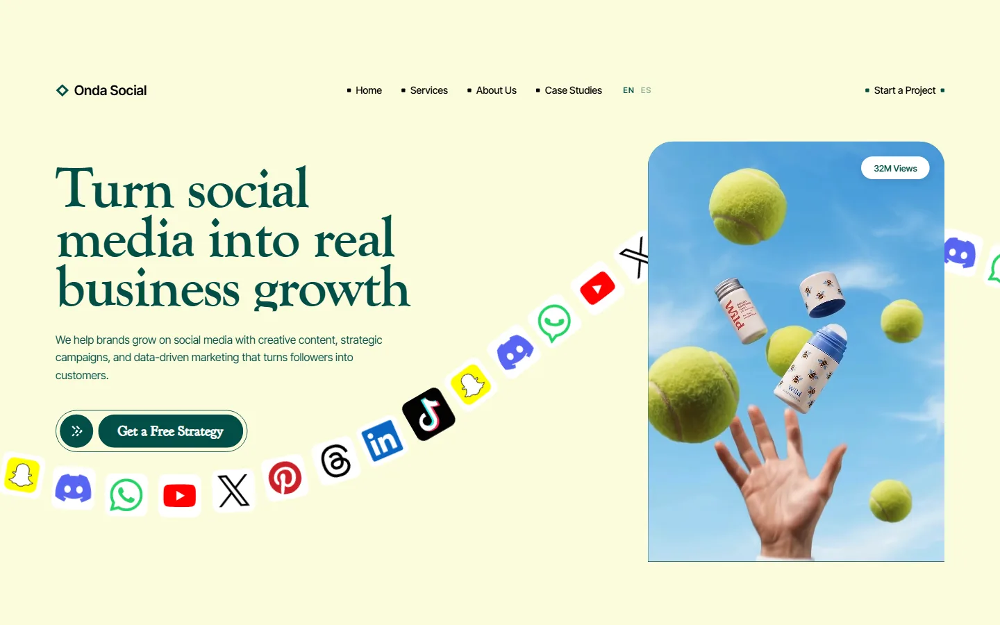

# Onda Social — Social Media Agency Landing

A faithful, bilingual rebrand of a social-media agency landing page: ten animated sections, a scroll-driven services deck, an interactive case-study selector, pricing, testimonials, an FAQ and a full-width contact footer.



## Overview

Onda Social keeps the original composition, motion and media of the reference build — the fixed 1600 px artboard, the sticky services cards, the icon orbit, the marquee, the scroll-linked process steps and the hero reel — and replaces only what could not ship as-is: brand names, third-party client logos, stock people photography and the vendor credit.

English and Spanish are both statically generated from typed dictionaries; the language switch preserves the current route.

## Key Features

- **Faithful port:** every section, animation and interaction of the reference is preserved (`framer-motion`, scroll progress, sticky stacking, marquees).
- **Bilingual (`en` / `es`):** typed dictionaries shared with the metadata, OpenGraph card, JSON-LD and 404 page, plus `Accept-Language` negotiation and an `onda.locale` cookie.
- **Self-hosted everything:** no remote images, fonts, videos or CDNs. Media lives in `public/media`, fonts (Inter Tight, Goudy Bookletter 1911) in `public/fonts`.
- **Fictional roster:** the client logos and case studies are invented (Velora, NourishCo, LUMASKIN, techora_, RIDEON, NORDIKA) and the figures are illustrative.
- **SEO:** canonical + `hreflang` alternates, multilingual `sitemap.xml`, `robots.txt`, a generated 1200×630 OpenGraph card and `Organization` / `Service` / `FAQPage` JSON-LD.
- **Localised 404** through a `[locale]/[...rest]` catch-all.

## Tech Stack

- Next.js 16.4.3 (App Router, Turbopack), React 19
- TypeScript 5.7 (strict), Tailwind CSS 4 for the base layer
- `framer-motion` for the original motion system
- `@vercel/analytics`
- pnpm 11.17

## Getting Started

```bash
git clone https://github.com/JORDANROBERTO74/onda-social.git
cd onda-social
pnpm install
pnpm dev
```

`/` redirects to `/en` or `/es` from the request headers.

```bash
pnpm typecheck   # tsc --noEmit
pnpm lint        # eslint
pnpm build       # production build
```

## Architecture

```
onda-social/
├── docs/                 # provenance ledger, preview, comparison captures
├── public/
│   ├── fonts/            # Inter Tight + Goudy Bookletter 1911 (woff2)
│   └── media/            # images, platform logos, two reels
└── src/
    ├── app/
    │   ├── [locale]/     # layout, page, 404, OpenGraph image, catch-all
    │   ├── globals.css   # @font-face, base layer, locale typography
    │   └── icon.svg      # diamond brand mark
    ├── components/
    │   ├── sections/     # header, about, services, case-studies, why-us,
    │   │                 # process, pricing, testimonials, faq, footer
    │   └── language-switcher.tsx
    ├── config/site.ts
    ├── i18n/             # config, dictionaries, copy context
    ├── lib/              # seo.ts, json-ld.ts
    └── proxy.ts          # locale negotiation
```

Section components read copy through `useCopy()` (`src/i18n/copy-context.tsx`), so the same client tree renders either locale without prop drilling.

## Deployment

Vercel, default Next.js preset:

```bash
vercel deploy --prod
```

`NEXT_PUBLIC_SITE_URL` overrides the canonical origin; otherwise it falls back to `https://ondasocial.vercel.app`.

## Accessibility Notes

- One `h1` per locale, semantic landmarks and labelled controls.
- The original layout is a scaled 1600 px artboard; on small screens it renders as a scaled-down composition rather than a reflowed layout. That is a deliberate fidelity trade-off.
- Spanish suppresses the source design's `text-transform: capitalize`, which is typographically wrong in Spanish.

## Compliance & Licensing

- No third-party client logos, trademarks, stock photography or likenesses.
- All faces were removed; replacement imagery contains no people.
- Platform icons (`public/media/social-1..9.svg`) are generic social-network glyphs, kept from the reference as requested.
- The reels are the reference's own demo media, kept as requested; see the note in [`docs/provenance.md`](docs/provenance.md).
- Case studies, metrics and testimonials are fictional.

Full audit trail: [`docs/provenance.md`](docs/provenance.md).

## License

Proprietary, all rights reserved. See [LICENSE](LICENSE).
